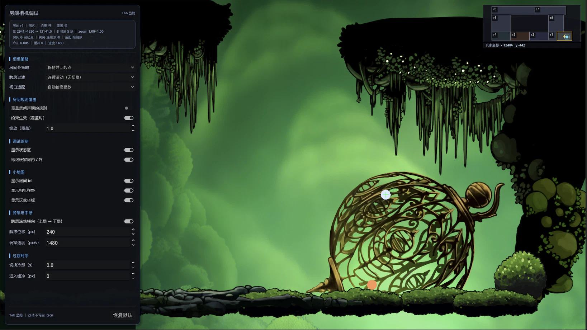

# Seamless Rooms · 示例项目

> 插件的最小可运行示例：8 间房、连续滚动相机、距离流式实体、接缝过渡、调试面板与小地图。
> 插件本体的安装、配置格式、Runtime API 见 **[addons/seamless_rooms/README.md](addons/seamless_rooms/README.md)**。




*示例 `example/main.tscn`：WASD 移动，Tab 显隐调试面板；右上角小地图实时显示玩家坐标与相机视野。*

---

## 运行

用 Godot 4.7 打开本目录的 `project.godot`，按 **F5** 运行示例（主场景 `res://example/main.tscn`）。也可以用命令行：

```bash
# 在仓库根目录执行
godot --path .
```

### 示例操作

| 输入 | 作用 |
|---|---|
| `W` `A` `S` `D` / 方向键 | 移动白色玩家（不受重力，四向自由移动） |
| `J` / `L`、`Space` 或 `I` | 移动 / 跳跃橙色角色（受重力，会落在 r1 的平台上） |
| `K` | 对最近的怪造成 15 点伤害（两下击杀，掉落金币） |
| `E` | 靠近宝箱时打开 |
| `Tab` | 显示 / 隐藏相机调试面板 |
| 面板 | 切换相机策略、跨房过渡、规则覆盖、跨层冻结；调玩家速度；开关小地图角标 / 视野 / 坐标 |

橙色角色只是场景里的第二个普通节点，用来演示「插件不参与玩家管理」：加载中心始终只有 `track()` 注入的那一个目标。

---

## 示例层说明

示例把「插件能力」和「游戏层拼装」分开：

- `example/main.gd` 只负责 `configure → track → ensure_room → to_world` 的装配顺序；
- 房间场景只放背景、静态装饰、碰撞和出生点；
- 玩家、怪物、宝箱、掉落物统一挂在 `Main/Actors`，由游戏层管理；
- 接缝遮罩 `Main/SeamBlend`、相机、调试面板、小地图、视差都是可删的示例层。

### 相机控制器

> 本节只讲示例层怎么用插件提供的几何 / 生命周期 API；插件 API 本身见 [插件 README](addons/seamless_rooms/README.md)。

示例用**全局唯一** `Camera2D`，由 `example/camera/room_camera_controller.gd` 驱动：每帧 `streamer.room_at(player.global_position)` 取房间 → 读 `SeamlessRoom2D.camera_rules()` → 把 `limit_*` / `zoom` 与相机位置夹在**约束区**内。插件全程不碰相机；配置几何同步可用，房间还在异步加载时也能立即锁好边界。

示例地图共 8 间房：底层从左到右是 r4 → r3 → r2 → r1；r5 叠在 r4 上方，r6 再叠在 r5 上方，r7 与 r6 同层向右延伸，r8 位于 r1 上方、同时与 r7 右侧贴边。整体是一块带 L 形转角的连通区；共享边由 `cells` 自动派生，基线版本为 8 条（5 竖直 + 3 水平）。

#### 连续滚动（默认）

房间配置是静态的，相机中心的可滚动范围能提前算出来。`SeamlessRoomCameraRegion.build(rects, view_size)` 以「与当前房间边贴合连通的矩形集合」和可见世界尺寸为输入，用坐标压缩求出所有满足「视图被房间并集完全覆盖」的相机中心，合并成少量矩形。

结果按「覆盖矩形签名 + 可见尺寸」缓存：签名与矩形顺序无关，连续滚动下同一片连通区跨房不变，所以切房直接复用预计算结果，只有进入另一个连通岛、或视口 / zoom 变化才重跑。运行期每帧只查表：

- 目标点合法 → 直接采用；
- 直线可达 → 用线段与各合法矩形的交区间**精确投影**；
- 直线被挡住 → `waypoint()` 走两段折线（先纵向对齐水平带，或先横向进入 L 形竖直通道），每段都做直线可达校验；
- 所有分支统一限速（`0.02 × 可见宽 + 玩家单帧位移`），避免目标突然合法时一帧跳几百像素；
- 传送 / 策略切换时用 `nearest()` 直接落到目标附近的合法中心。

纵向只在「房间高度不超过视口」时约束到中线；房间高于视口（r5 高 2160）时放开纵向。跨层回落按 `1.2 × 视口高/秒` 平滑逼近中线，不会一帧切掉上一层。包围盒 `touching_bounds(id)` 只用于 `limit_*` 粗约束、`auto_fit` 缩放与 HUD 数值。

由此得到的行为：从 r1 走到 r2 时 limit / zoom / 覆盖集合都不变，相机按死区继续水平滚动，视图自然越过接缝；从 r4 直接向上进 r5 时两者 x 完全对齐，相机沿竖直通道连续上移；上下层房间宽度恰好等于视口宽时（例如 r8 为 1920），横向合法区退化为一条线，相机会先把 x 对齐再上移。回程同理，玩家全程不出画。

#### 策略与调试面板

所有策略集中在 `example/camera/camera_policy.gd`，运行时热切换（`changed` 信号触发控制器幂等重算）：

| 开关 | 取值（默认） | 说明 |
|---|---|---|
| `out_of_room` | `HOLD_LAST` / **`HOLD_AND_RESPAWN`** / `UNLOCK` / `NEAREST_ROOM` | 玩家不在任何房间时：保持上一房 / 保持并回起点 / 解除 limit / 用最近房间规则 |
| `room_transition` | **`CONTINUOUS`** / `HARD_CUT` | 连续滚动（不换边界） / 硬切一屏 |
| `switch_cooldown` / `enter_margin` | `0` / `0` | 切换冷却、进入缓冲，消除贴边界反复切屏 |
| `override_room_rules` + `override_*` | `false` | 用面板数值覆盖所有房间声明，便于横向对比 |
| `freeze_x_on_layer_change` / `freeze_release_margin` | `true` / `240` | 上层 → 下层跨层后冻结横向跟随；玩家水平位移超过该值解冻 |
| `player_speed` | `1480` | 玩家速度（px/s），面板热调 |
| `show_hud` / `show_player_room` | `true` | 中文状态区、玩家「房内」/「房外」标记 |
| `show_minimap_ids` / `show_minimap_camera` / `show_minimap_coords` | `true` | 小地图房间角标 / 相机视野 / 玩家坐标 |

面板贴在左上角：标题栏（标出 `Tab`）、状态区、可滚动设置区、页脚。设置区按「相机策略 / 房间规则覆盖 / 调试绘制 / 小地图 / 跨层与手感 / 过渡时序」分组；状态区显示房间、房内房外、约束区、缩放与策略、冻结与冷却，几何越界时追加红字警告。

| 想对比 | 操作 | 预期 |
|---|---|---|
| 连续滚动 vs 切屏 | 面板切「跨房过渡」，从 r1 走到 r2 | 连续：相机持续滚动、limit 不变；硬切：整屏跳到 r2 并对准玩家 |
| 锁边有没有用 | 勾「覆盖房间声明的规则」并关「约束生效」，在 r5 里向右走 | 开：停在房间右缘；关：跟到空白区，露出世界网格 |
| 房间外四策略 | 依次选四种，开局按 `D` 约 1.5 秒出 r1 | 画面稳住 / 回起点 / 自由跟随 / 最近房规则切换 |
| 视口大于覆盖区 | 硬切 + 缩放 `0.5`，再轮换「视口适配」三项 | 自动抬高 zoom 填满 / 露出房外并红字警告 |
| 跨层冻结 | 开关「跨层冻结横向」，从 r5 右下角向下进 r4 | 开：保持 x 停在 r4 右半；关：限速右滑到交界 |

调试面板、`override_*` 与显示开关都是**开发期脚手架**，不是插件的公共 API。正式项目建议把「相机运行参数」与「开发期调试开关」拆成两份数据：房间只声明自己那一间的构图参数，跨房过渡与防抖交给统一持有相机的业务系统。

### 实体分层与房间怪物

房间场景只负责背景、静态装饰、碰撞和出生点；玩家、怪物、宝箱、掉落物统一挂到 `Main/Actors`（`y_sort_enabled = true`，`z_index = 10`），由 `RoomEntityDirector` 按 streamer 的挂载状态生成/回收。

```text
r1.tscn: World/Spawns/EnemySpawn_01 (领地/仇恨/leash)
				│ room_mounted
				▼
main.tscn: Main/Actors/r1_EnemySpawn_01  ← 与 Player 同容器，按 Y 排序
				│ room_sleeping
				▼
			  queue_free
```

- 怪物用 `EnemySpawn` 标记，宝箱用 `ChestSpawn`，固定掉落用 `PickupSpawn`；加房间只改房间场景，不改 `main.tscn`。
- 领地半径应小于 `sleep_distance`，保证怪追人时房间不会休眠。
- `r1` 的 `FgParallax/Occluders` 是 `scroll_scale = (1, 1)` 的遮片层，用来放会盖住角色的树冠 / 草叶；1.06 的 `Foreground` 只做纯装饰。
- 完整约定、z band、物理层和 100 间房的运行时上界见 **[docs/entity-layering.md](docs/entity-layering.md)**。

### 小地图 demo

`SeamlessRoomMinimap` 是一个纯显示 `Control`：外部每帧把玩家世界坐标与相机视野推给它，它只负责按配置里的房间几何绘制。示例把 `MinimapLayer`（`layer = 2`）与右上角锚定的 `Minimap` 放在 `example/main.tscn` 里（`@tool`，编辑器可直接预览）；`main.gd` 的 `_build_minimap()` 只注入配置与调试开关，运行时：

```gdscript
minimap.configure(config)
minimap.set_cursor_world_position(player.global_position)
minimap.set_camera_view(Rect2(center - view * 0.5, view))
```

完整成员表、导出参数与绘制分层见 **[插件 README 的小地图章节](addons/seamless_rooms/README.md#可选配套-seamlessroomminimap)**。

### 视差 demo

层骨架来自 `example/rooms/room_template.tscn`：它用 `SeamlessRoomParallax` 把房间分成背景 / 世界 / 前景三组，只有空层；`r1`–`r8` 全部继承它。模板只放结构性契约节点（`Backdrop` / 8 个视差 band / `Underlay` / `Spawns`），准入标准见 [docs/parallax-convention.md](docs/parallax-convention.md)；`r1.tscn` 提供苔藓洞窟的内容并自建 `World/Water / Terrain / Obstacles / Props` 4 个分组，`r2.tscn` 迁入 `moss_hole_0` 的 102 个视差层（20 个背景 + 82 个前景）与 61 个 `World/Decor` 节点，其余 6 间房只有房间身份覆写：

```text
RoomTemplate（SeamlessRoom2D，由 r1–r8 继承）
├─ BgParallax（z = -100，clip_to_room = true，Room Center）
│  ├─ Backdrop（房间固定静态背景，不参与视差）
│  ├─ Far（scroll_scale = 0.55）
│  ├─ Far2（0.75）
│  ├─ Mid（0.87）
│  └─ Near（0.95）
├─ World（Underlay z = -10 / Spawns；模板为空）
└─ FgParallax（z = 100，clip_to_room = true，Room Center）
   ├─ Occluders（1.0，z = 20）
   ├─ Foreground（1.06）
   ├─ FG2（1.18）
   └─ FG3（1.30）
```

`r1.tscn` 把 95 个原 `Bg_XXX` 合并为 band 下的 `Sprite2D`；`r2.tscn` 用同样的方式迁入 102 个视差层（按 `move_layer` 归到 7 个 band，坐标按 `Room Center` 重投影），两间房都把 `Darkness` 挂在 `BgParallax/Backdrop` 下，视差参数只保留在 band 上，相机在房间中心时构图与旧版一致。贴图全部复用 `example/assets/sprites/moss_hole/`，`r2` 不引入新的图片 / shader / 音频资源。比例是模板默认值，单房可在继承节点上覆写 `scroll_scale`；以后加层、改 z band 一律改模板。之后加素材只需要选中 band，把贴图拖进 2D 视图，`scroll_scale` 都不用碰。

组件的 `scroll_scale` 语义、参照系、位移钳制、Fade 模式与迁移映射见 **[插件 README 的视差章节](addons/seamless_rooms/README.md#可选配套-房间局部视差-seamlessroomparallax)** 和 **[docs/parallax-convention.md](docs/parallax-convention.md)**。

### 接缝过渡 demo

示例在地图上启用了 r1 / r2 之间的一条竖直缝，演示插件的两种接缝过渡实现共用同一份数据。完整规则、参数与实现细节见 **[docs/seam-blending.md](docs/seam-blending.md)**。

- **数据**：`world_config.tres` 的 `seams` 里有一条 `r2 → r1`、`axis = Vertical`、`enabled = true` 的记录；`width_ratio = 1/3`、`core = 0.0`、`feather_min = 1.35`、`color` 为已调好的暗绿色。`width_max = 0`（不限），因此单侧半宽 = 1080 / 3 = 360 px。
- **几何**：坐标不落盘，由两侧 `cells` 派生。r2 的右边界与 r1 的左边界都在 `x = 10141`，重叠区间 `y ∈ [-1080, 0]`，所以遮罩是 `720 × 1080`，中心正好压在接缝上。
- **Overlay（`seam_mode = 0`，当前示例）**：`example/main.tscn` 里的 `SeamBlend` 节点挂 `SeamlessRoomSeamBlend`，`config` 指向同一份 `world_config.tres`，`z_band` 取默认 `-101`。运行时生成 1 个 `Veil_r1_r2_0`，压住 `z = -121…-102` 的背景 Sprite，同时保留 `WorldGrid` 的 `-100`。
- **Fade（`seam_mode = 1`）**：把 `world_config.tres` 的 `seam_mode` 改成 `Fade` 即可切换。此时 `SeamBlend` 自动跳过生成；`SeamlessRoomStreamer` 在挂载 r1 / r2 时把共享边注入 `SeamlessRoom2D.seam_edges`，模板里的 `BgParallax/Far / Far2 / Mid / Near` 自动挂上渐隐材质，`Backdrop/Darkness` 保持实心底色，`FgParallax` 不参与。
- **编辑器**：在 dock 上点「接缝模式」，单击画布上的共享边即可看到绿色实线与渐变预览；右侧可启用 / 移除过渡并调参数，保存后写回 `world_config.tres`。

共享边由布局自动派生；文档基线的 8 房地图为 8 条（5 竖直 + 3 水平），只有 r1/r2 被显式启用，其余边保持默认虚线、不生成任何遮罩。r7/r8 之间是**部分重叠**（基线为 `y ∈ [-4280, -3240]`，span 1040），遮罩只覆盖重叠段，不会画到没有接缝的区域；拖动 / 缩放房间后以 dock 报告与 `layout.seams()` 为准。

两条遮罩在拐角相交时（例如 r4/r5 水平缝与 r3/r4 竖直缝在 `(741, -1080)` 相接）按 `blend_premul_alpha` 合成，不缩短端点。Overlay 的遮罩常驻 `Main` 层，房间卸载后仍会保留；需要「随房间消失」时改用 Fade。

---

## 目录结构

```text
godot4-seamless-rooms/
├── project.godot
├── world_config.tres                 # 运行期地图配置（8 间房 + 1 条接缝，1px 网格）
├── room_library.tres                 # 编辑期资源库（导入列表 + 尺寸基线）
├── screenshot/                       # 运行 / 编辑器截图
├── docs/
│   ├── seam-blending.md              # 接缝过渡：数据 / 画布 / Overlay / Fade
│   ├── parallax-convention.md        # 视差规范
│   └── entity-layering.md            # 实体分层与房间怪物
├── addons/seamless_rooms/            # 插件本体；文档见 addons/seamless_rooms/README.md
└── example/                          # 最小可运行示例，不属于插件本体
	├── main.tscn / main.gd           # 静态场景 + 装配序列
	├── assets/                       # 按资源类型 / 主题组织
	│   ├── sprites/moss_hole/        # r1 / r2 使用的贴图
	│   └── effects/                  # 水面等 SpriteFrames
	├── rooms/                        # 房间场景；根节点继承 room_template.tscn
	│   ├── room_template.tscn        # 层骨架模板（不是房间，不入库 room_library / world_config）
	│   └── r1.tscn … r8.tscn         # r1 / r2 为苔藓洞窟场景，其余为空白房间
	├── actors/                       # 按实体类型分；场景 + 脚本 + 出生点同目录
	│   ├── player/                   # player.gd / player2.gd
	│   ├── enemies/                  # enemy_slime.gd/.tscn / enemy_spawn.gd
	│   ├── interactables/            # chest.gd/.tscn / chest_spawn.gd
	│   ├── pickups/                  # pickup.gd/.tscn / pickup_spawn.gd
	│   └── room_entity_director.gd   # 房间实体供给器
	├── camera/                       # 相机策略与控制器
	│   ├── camera_policy.gd
	│   └── room_camera_controller.gd
	├── ui/                           # 调试 UI / 覆盖层
	│   ├── camera_debug_panel.gd
	│   └── debug_overlay.gd
	├── world/                        # 世界级辅助
	│   └── world_grid.gd
	└── tests/                        # headless 自检
		├── camera_rules_probe.gd      # 相机规则 / 视差组件
		├── room_template_probe.gd     # 8 房继承模板 / 身份覆写 / 层默认值
		└── seam_probe.gd              # 接缝数据 / 几何 / 画布公式 / Overlay / Fade
```

`example/rooms/` 里 `room_template.tscn` 是层骨架模板（根节点挂 `addons/seamless_rooms/runtime/seamless_rooms_room2d.gd`），不是房间，不加入 `room_library.tres` / `world_config.tres`；`r1`–`r8` 的根节点都继承模板（模板根节点挂 `SeamlessRoom2D`），派生场景必须显式覆写 `room_id / room_title / room_size`（dock 只读 `PackedScene.get_state()` 的根节点属性）。示例层不再维护自己的房间脚本；需要自定义房间行为时，按 [插件 README](addons/seamless_rooms/README.md) 的「房间基类与相机规则」继承 `SeamlessRoom2D` 即可。

插件自身的目录结构见 [addons/seamless_rooms/README.md](addons/seamless_rooms/README.md)。

---

## 验证

```bash
GODOT=godot    # macOS 图形版可写 /Applications/Godot.app/Contents/MacOS/Godot
PROJ=$(pwd)    # 在仓库根目录执行

# 1) 资源导入 + 脚本解析（会生成 .uid 文件，务必入库）
$GODOT --headless --path "$PROJ" --import

# 2) 跑几帧，确认示例主场景无运行时报错
$GODOT --headless --path "$PROJ" --quit-after 5

# 3) 单文件语法检查（示例 + 插件）
cd "$PROJ"
for f in $(find addons example -name '*.gd'); do
  $GODOT --headless --path "$PROJ" --check-only --script "res://$f" || exit 1
done

# 4) 相机规则自检（limit / zoom / 桶边界 / 半径注入 / 覆盖区签名 / 200 房大地图 / 视差组件）
$GODOT --headless --path "$PROJ" --script res://example/tests/camera_rules_probe.gd

# 5) 房间模板自检（8 房身份覆写 / 18 条继承层 / 视差默认值 / r1 内容）
$GODOT --headless --path "$PROJ" --script res://example/tests/room_template_probe.gd

# 6) 接缝自检（共享边几何 / 校验分级 / 预览公式 / Overlay 遮罩 / Fade 注入）
$GODOT --headless --path "$PROJ" --script res://example/tests/seam_probe.gd

# 7) 启动编辑器若干帧，确认 dock 构建 / 资源库加载无报错
$GODOT --headless --path "$PROJ" --editor --quit-after 90
```

`.uid` 与 `.tscn` / `.tres` 需要入库；`.godot/` 已在 `.gitignore` 中忽略。移动或重命名脚本 / 场景请在 Godot 编辑器内操作，否则 `uid://` 引用会断。拖拽落图、导入对话框属于 GUI 交互，headless 只能验证脚本与资源，需在编辑器里人工试一遍。

> `seam_probe.gd` 的 49 项断言以文档基线的 8 房地图为准；若在编辑器里移动 / 缩放房间，边数与区间会变，需要同步 probe 的期望值。`camera_rules_probe.gd` 另有 5 项期望值仍绑定地图改版前的 r4 / r5 坐标，属于历史基线；`room_template_probe.gd` 不受影响。

---

## 已知限制（示例层）

- **示例层不提供房间外遮罩**：房外内容（`WorldGrid`、超出 `room_size` 的 Sprite2D）在视图越界时会直接可见；需要「房外不可见」时请在自己的渲染层按房间矩形并集做差集遮罩。
- **连续滚动允许视图跨房**：这是「没有切换过程」的前提；若相邻房间尚未挂载会短暂看到空白，由有效挂载半径提前供给。
- **`Camera2D.offset` 会推过 limit**：偏移在 limit 计算之后叠加，示例把 `camera_offset` 加在相机 `global_position` 上，并保持 `cam.offset = Vector2.ZERO`。
- **相机规则在房间场景里，未挂载时用默认值**：规则不写进 `world_config.tres`，因此地图 dock 不展示它们；控制器用 `ensure_room()` 兜底。
- **示例策略开关只影响运行期**：`override_room_rules` 与调试面板的改动不写回 `.tscn`，重启恢复房间声明值。
- **Overlay 遮罩不随房间卸载**：`SeamBlend` 常驻 `Main`，r1/r2 都卸载后会留下孤立暗带；需要随房间消失时切到 Fade，或由游戏层按 `mounted_ids()` 自行显隐。
- **Fade 依赖模板的背景 band**：示例的渐隐只作用于 `BgParallax` 的 `Far / Far2 / Mid / Near`，`Backdrop/Darkness` 与 `FgParallax` 保持原样；自定义房间若没有这些 band，应改用 Overlay。
- **Fade 每房最多 2 条共享边**：shader 只有两个槽位，超出时告警并只应用前 2 条；示例每间房最多 2 条，不受影响。
- **只有 r1 / r2 有内容**：其余 6 间房是空白房间，用来看流式加载、相机几何与接缝几何。

插件本体的已知限制（LRU、floating origin、桶尺寸、调度参数全局等）见 [addons/seamless_rooms/README.md](addons/seamless_rooms/README.md#已知限制)。

---

## 插件文档

- [插件 README：安装 / 配置格式 / 编辑器 dock / Runtime API](addons/seamless_rooms/README.md)
- [接缝过渡：共享边 / 画布配置 / Overlay / Fade / 校验](docs/seam-blending.md)
- [视差规范：scroll_scale / 参照系 / 分层 / z band / 迁移](docs/parallax-convention.md)
- [实体分层：z band / y-sort / 房间怪物 / 拾取物](docs/entity-layering.md)
