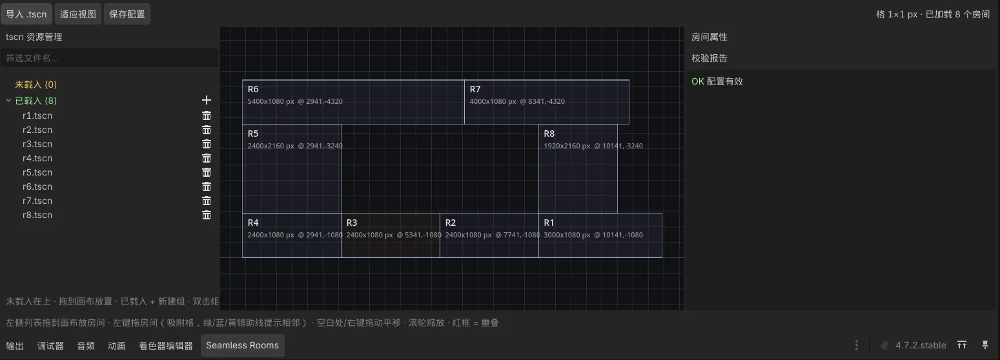

# Seamless Rooms

> 编辑期把房间摆在一张网格大地图上，导出一份 `.tres` 配置；运行期按这份配置，以跟踪目标为中心流式加载房间内容。




*编辑器底部 dock：8 间房按 `world_config.tres` 排布，状态行显示「格 1×1 px · 已加载 8 个房间」；左栏「已载入 (8)」，右栏「校验报告」显示「OK 配置有效」。*

---

## 安装

1. 把 `addons/seamless_rooms/` 复制进目标项目（`companion/` 不需要可以删）。
2. 在「项目设置 → 插件」里启用 **Seamless Rooms**。
3. 编辑器底部会出现 **Seamless Rooms** dock；不存在配置文件时会自动创建。
4. 让房间场景根节点继承 `SeamlessRoom2D`（或至少声明 `room_id` / `room_title` / `room_size` 三个属性）。
5. 在 dock 里导入 `.tscn`，拖到画布上摆好，点「保存配置」。
6. 运行时添加 `SeamlessRoomStreamer` 节点，`configure(config)` 后 `track(target)` 即可。

> 插件在编辑器打开期间升级过的话，需要重新打开项目（或在插件面板禁用再启用）：`EditorPlugin._enter_tree()` 只在插件加载时执行一次。

完整示例见仓库根目录的 [`example/`](../../example) 与 [根 README](../../README.md)。

---

## 特性

| 能力 | 说明 |
|---|---|
| **可视化编排** | 编辑器底部 dock：tscn 资源列表 + 网格画布 + 属性面板 + 校验报告。拖拽吸附、x/y 辅助线、重叠红框、撤销重做 |
| **单一配置** | 运行期只认一份 `SeamlessRoomConfig`（`.tres`），Inspector 原生可编辑、类型安全、可 diff，也能手写 |
| **距离流式加载** | `mount → sleep → unload` 四级生命周期 + 滞回带；`PackedScene` 缓存 LRU 淘汰，释放的只是实例 |
| **网格与索引解耦** | `cell_size` 可以细到 1px（格坐标即像素坐标），空间索引用独立配置的桶，索引开销不随网格粒度膨胀 |
| **相机几何** | 房间只声明自己的构图规则；插件提供纯几何计算与「相机中心合法区域」预计算，不寻找、不驱动任何 `Camera2D` |
| **可选配套** | `SeamlessRoomMinimap` 小地图、`SeamlessRoomParallax` 房间局部视差，都在 `addons/` 内，整套可以删掉 |

**引擎**：Godot 4.7（实测 4.7.2）· **渲染器**：Forward+ / GL Compatibility 均可（纯 2D，不依赖渲染特性）· **无第三方依赖**

---

## 它不做什么

边界比功能更重要：

| 插件**不认识** | 原因 |
|---|---|
| 门、传送门、接缝、连通性 | 房间之间怎么来往是游戏层的事 |
| 玩家、相机、出生点 | 插件只接受一个 `track()` 注入的跟踪目标，从不移动任何节点 |
| 钥匙、锁、剧情、进度 | 属于关卡内容，随房间加载 / 卸载 |
| 房间之间的可达性 | 不做可达性校验；留空、跳跃、飞行过去都是合法设计 |
| 程序化无限生成 | 不生成地形，只负责「已注册的房间」按距离加载 |

一句话：**插件是一台按位置供给房间内容的机器，外加一组纯几何 / 生命周期的原子 API；玩法由游戏层自己拼。**

`addons/seamless_rooms/companion/` 下的视差组件是唯一的表现层例外：它不认识相机，只消费游戏层每帧推入的相机中心，不寻找、不驱动任何 `Camera2D`。

---

## 工作原理

```text
room_library.tres ──(编辑器 dock)──> world_config.tres
                                          │
                             SeamlessRoomStreamer.configure(config)
                                          │  track(target)
                                    每 tick 按距离判定
                                          │
                    request / instantiate / sleep / unload
```

### 1. 格坐标，不是世界坐标

配置里房间的位置是 `Rect2i cells`，运行时才乘 `cell_size`：

\[
\text{world\_rect} = \text{Rect2}\big(\text{cells.position} \odot \text{cell\_size},\; \text{cells.size} \odot \text{cell\_size}\big)
\]

**`cell_size` 的单位就是像素**，示例取 `Vector2(1, 1)`，一格 1×1 px，格坐标 == 世界像素坐标。于是 `world_config.tres` 里 r1 写 `Rect2i(10141, -1080, 3000, 1080)`，房间边界精确到 1px，任意宽高都可以。

房间内容在 `.tscn` 里本来就用局部像素坐标摆放，`cell_size` 只决定编辑器吸附步长与画布网格线，两者用的是同一把像素尺。好处：整数可校验、可 diff、无浮点误差；相邻房间的边界由整数相加得出，**严丝合缝是网格的副产品，不需要任何「对齐数据」**。

### 2. 空间索引与网格解耦

`cell_size` 只管坐标换算、编辑器吸附和画布网格线；**空间索引用另一套独立尺寸的桶**，由 `SeamlessRoomStreamingSettings.bucket_size` 配置（`<= 0` 时按地图房间短边中位数自动推导）。房间按它覆盖的桶登记，而不是逐格登记。

示例把桶尺寸设为 `1080`：它同时等于示例视口高和示例房间高，所有横向层边界恰好落在桶线上，`room_at()` 的一个桶里不会同时挤进上下两层房间。

这个解耦是 1px 网格能成立的前提：若按格逐格登记，一间 2400×1080 的房就是 259 万个桶，启动即爆内存。解耦后索引开销只与房间数量和**世界**尺寸有关，与 `cell_size` 无关。

`query_near()` 枚举的桶数约为 \((2r/B+1)^2\)，与房间总数无关，但随半径平方增长，并在超过 `MAX_QUERY_BUCKETS = 4096` 时截断半径并告警。

### 3. 四级生命周期

| 状态 | 触发 |
|---|---|
| 未加载 | 初始 |
| 线程加载中 | `request_room()` 发起 `ResourceLoader.load_threaded_request()` |
| 已挂载 | 加载完成 → `instantiate()` → `add_child()`，摆到世界原点 |
| 休眠 | 距离 > `sleep_distance`：隐藏、`PROCESS_MODE_DISABLED`、关碰撞 |
| 释放节点 | 休眠且距离 > `unload_distance`：`queue_free()` |

`PackedScene` 留在缓存里，所以释放的只是实例，回头不用重新读盘。`mount < sleep < unload` 形成滞回带，避免边界抖动。运行期有效值由 `set_load_radius()` 派生，`effective_distances()` 可只读查询，配置资源不会被写回。

### 4. 加载半径由游戏层注入

插件不做任何视口推算（它不认识相机、玩家、视口）。**游戏层**按当前可见世界尺寸算出「该提前加载多远」，再用 `streamer.set_load_radius(r)` 注入一个世界单位的长度；插件把它夹在 `[mount_distance, 查询桶预算]` 内，并按同一比例派生 `sleep / unload`，保持滞回带形状不变。未注入时等于配置基准，行为与静态配置完全一致。

示例层的公式在 `example/camera/room_camera_controller.gd` 的 `compute_load_radius()`（插件本体不包含这段推算）：

\[
r = \sqrt{(\tfrac{vw}{2}+|dz_x|+|off_x|)^2 + (\tfrac{vh}{2}+|dz_y|+|off_y|)^2}
    \;+\; v_{player}\cdot \text{tick} \;+\; \text{load\_latency\_margin}
\]

| 量 | 来源 |
|---|---|
| `vw, vh` | `_view_size = viewport / zoom`，在 `_apply_camera_bounds()` 算出 |
| `dz` / `off` | 房间规则的 `camera_deadzone = (220,140)` / `camera_offset = (0,-60)` |
| `v_player` | `Player.move_speed`（默认 1480，面板可热调） |
| `tick` | `SeamlessRoomStreamingSettings.tick = 0.12` |
| `load_latency_margin` | 控制器常量 `LOAD_LATENCY_MARGIN = 240`，覆盖异步加载期间玩家继续移动 |

1920×1080 默认参数下 \(r\approx1810\)，1280×720 约 1444，3840×2160 约 2911，都远在桶预算内。分辨率、`zoom`、策略变化都会走幂等入口 `_apply_camera_bounds()`，注入值自动更新。

---

## 编辑器：Seamless Rooms dock

插件启用后，编辑器**底部 dock** 会出现 **Seamless Rooms · 地图**，分三栏：左侧 tscn 资源管理、中间网格画布、右侧上下两块（房间属性 / 校验报告）。两条 `HSplitContainer` 分隔条可拖动，位置保存在 `EditorSettings`（用户级，不进项目）。整条顶栏右侧常驻状态行，显示格尺寸与已加载房间数。

dock 文案中英双语，跟随「编辑器设置 → 界面 → 编辑器 → 编辑器语言」；切换语言并重开编辑器后自动生效。运行时组件的文案跟随项目当前 locale，非中文环境回退英文。

### 数据文件

| 文件 | 作用 |
|---|---|
| `res://world_config.tres` | 运行期地图配置（`SeamlessRoomConfig`），示例含 8 间房 |
| `res://room_library.tres` | 编辑期已导入列表（`SeamlessRoomSceneLibrary`），运行期不加载 |

默认在项目根目录读写。换目录时在 `project.godot` 里加：

```ini
[seamless_rooms]
config_path="res://data/world_config.tres"
library_path="res://data/room_library.tres"
```

也可以在「项目设置 → Seamless Rooms」里改（已注册默认值与 `*.tres` 文件选择器）。文件不存在时插件会自动创建空配置、空库，父目录一并创建。

### 画布操作

| 操作 | 说明 |
|---|---|
| 左键拖动房间 | 按 `cell_size` 吸附，并在约 10 屏幕 px 内自动贴相邻房间边界 / 共线；松手才提交（可撤销） |
| 空白处 / 右键拖动 | 平移视图 |
| 滚轮 / 双指捏合 | 以鼠标位置为中心缩放 |
| 单击房间 | 选中并高亮；右侧上半段只读（`id` / `title` / `scene` / `w` / `h`），下半段可改（`x` / `y` / `tint`） |
| 单击「已载入」 | 视图平移到对应房间并显示完整属性 |
| 单击「未载入」 | 右侧只显示该 tscn 声明的 `id` / `title` / `scene` / `w` / `h` |
| `导入 .tscn` | 多选项目内场景加入列表；新条目落在「未载入」 |
| 列表 ⚠ 标记 | 保存 `.tscn` 后 `room_id` / `room_size` 与地图或库基线不一致时出现，行内可一键同步 |
| 每行右侧 × | 未载入 → 移出列表；已载入 → 从地图移除引用它的房间（可撤销） |
| 虚拟组 | `+` 新建组、双击改名、拖条目入组；删组只影响列表，不动 tscn 与地图 |
| 筛选框 | 按文件名过滤（大小写不敏感），组名命中时整组保留 |
| `适应视图` / `保存配置` | 缩放平移到全部房间 / 写回配置路径 |

**红色边框 = 格区间重叠**，必须修掉才能通过校验；绿色边框 = 当前选中。拖拽落图时鼠标位置就是房间 `cells.position`（左上角），不做中心偏移、不自动避让。

画布刻意只表达几何：没有「连接房间」「设置门」之类的操作。所有地图改动都走 `EditorUndoRedoManager`；导入与「移出列表」只改 `room_library.tres`，不进撤销栈。所有绘制都裁剪到画布矩形，放大到房间超出视口时不会溢出到编辑器其它 dock。

### 校验

`SeamlessRoomValidator.validate(config)` 只查几何与资源自洽：

- `cell_size` 为正、`rooms` 非空、`id` 唯一非空、`scene` 已指定、`cells.size` 为正
- **格区间两两不重叠**（重叠会让「谁覆盖谁」取决于加载顺序）
- `mount < sleep < unload`、`max_mounted >= 0`、`tick > 0`
- `mount_distance` 超出查询桶预算、`max_mounted` 过小时给出 WARN

面板还会检查库内多个 `.tscn` 声明同一个 `room_id`，命中时追加 WARN。右侧报告在每次地图改动后自动刷新；按 F5 前会再校验一次，**有 error 会阻止运行**。

**不查**连通性、可达性、缝隙、门对齐——这些不是布局层的职责。

---

## 配置格式

配置只有一份：自定义 `Resource`（`.tres`），Inspector 原生可编辑、类型安全、引擎管 UID，运行时由 `ResourceLoader` 直接加载。插件不生成 JSON 快照。

### SeamlessRoomConfig

| 字段 | 类型 | 说明 |
|---|---|---|
| `schema_version` | `int` | 当前为 `1`，用于格式迁移 |
| `cell_size` | `Vector2` | 网格大小，单位 px；示例 `Vector2(1, 1)`，只影响编辑器吸附与画布网格线 |
| `rooms` | `Array` | `SeamlessRoomPlacement` 列表；访问请走 `config.placements()` |
| `streaming` | `SeamlessRoomStreamingSettings` | 调度参数 |

### SeamlessRoomPlacement

| 字段 | 类型 | 说明 |
|---|---|---|
| `id` | `StringName` | 房间唯一标识 |
| `scene` | `PackedScene` | 房间场景；多个房间可共用同一份 |
| `cells` | `Rect2i` | 格坐标矩形；世界像素矩形 = `cells × cell_size` |
| `tint` | `Color` | 供房间内容 / 地图 / 调试层使用 |

> 编辑期约定：`id` 与 `cells.size` 在拖入地图时由场景根节点的 `room_id` / `room_size` 决定，之后只读；之后再改场景声明，左栏会出现 ⚠，可用行内同步写回地图（`id` 冲突时跳过）。可改的只有 `cells.position` 与 `tint`。

### SeamlessRoomStreamingSettings

| 字段 | 插件默认 | 说明 |
|---|---|---|
| `mount_distance` | `1000` | 基准下限；运行期有效值由 `set_load_radius()` 注入 |
| `sleep_distance` | `2000` | 休眠阈值基准，按有效半径同比例派生 |
| `unload_distance` | `4000` | 释放阈值基准，按有效半径同比例派生 |
| `max_mounted` | `0` | 同时挂载上限；`<= 0` 表示按有效半径与地图密度自动派生 |
| `tick` | `0.12` | 调度检测间隔（秒），也参与游戏层的半径公式 |
| `bucket_size` | `0` | 空间索引桶边长；`<= 0` 表示按地图房间短边中位数自动推导 |

**插件本体是中立兜底，不绑定任何示例视口或房间尺寸**；示例 `world_config.tres` 写的是 `1200 / 2200 / 4200 / 8 / 1080`（`tick` 未写，取默认 `0.12`），属于 example 层。

### 编辑期资源库

`SeamlessRoomSceneLibrary` 是**纯编辑期** Resource：`scenes`（已导入场景）、`sizes`（`room_size` 基线）、`groups` + `group_of`（虚拟分组）。它就是左栏列表的全部内容——项目里其余 `.tscn` 只通过「导入 .tscn」对话框选取，不会自动出现。

| 分区 | 判定 | 行为 |
|---|---|---|
| 未载入 | 在 `scenes` 中，但配置里没有任何 `placement.scene` 指向它 | 固定排在**上半区**；拖到画布放置房间 |
| 已载入 | 在 `scenes` 中，且至少有一个 `placement.scene` 指向它 | 排在下半区；可继续拖放复用 |

分区由**是否被拖入地图**决定，与运行期是否挂载无关。若一个资源被多间房引用，删除「已载入」项会一并移除这些房间。虚拟组只影响列表展示，删组不动 tscn 与地图。

---

## 房间基类与相机规则

房间场景根节点继承 `SeamlessRoom2D`（`addons/seamless_rooms/runtime/seamless_rooms_room2d.gd`）即可；插件按属性名识别，不依赖具体脚本文件：

```gdscript
@tool
extends SeamlessRoom2D

func _draw() -> void:
	super()   # 基类画编辑器边界预览，运行时自动跳过
	# 房间内容...
```

基类提供 `room_id`、`room_title`、`room_size` 和 `show_editor_bounds`，并在 **2D 编辑器**里常驻绘制边界预览：亮青主边框 + 四角外向角标、宽高尺寸线、每 100px 短刻度 / 500px 长刻度、四等分淡网格。`show_camera_bounds` 另外画橙色相机约束区预览。预览只在编辑器绘制，运行时不产生任何绘制。

### 相机规则（逐房间声明）

| 字段 | 默认值 | 说明 |
|---|---|---|
| `camera_confine` | `true` | 关闭后不再约束相机（恢复无限 `limit_*`），用于对比 |
| `camera_lock_mode` | `FOLLOW_CONFINED` | 跟随但视图不越界；`FIXED_CENTER` 固定房间中心 |
| `camera_bounds` | `Rect2(0,0,0,0)` | 房间局部可视区，`size <= 0` 表示整间房 |
| `camera_deadzone` / `camera_offset` | `(220,140)` / `(0,-60)` | 死区跟随参数；`(0,0)` = 每帧硬贴玩家 |
| `camera_zoom` | `(1,1)` | 期望缩放 |
| `camera_fit_mode` | `ZOOM_TO_FIT` | 视口大于房间时是否抬高 zoom |

基类只提供数据与纯几何计算，**不寻找、不移动任何 `Camera2D`**：

| 方法 | 说明 |
|---|---|
| `configure(id, placement, cell_size)` | 记录配置算出的权威世界矩形，不依赖房间是否进树 |
| `camera_rules() -> Dictionary` / `default_camera_rules()` | 输出 / 提供默认规则 |
| `limit_rect_from(world_bounds) -> Rect2i` | 世界矩形 → 四个 int limit，向内取整不留 1px 越界 |
| `clamp_camera_position(desired, bounds, view) -> Vector2` | 把相机中心夹到「可见矩形完全落在房间内」 |
| `required_zoom(bounds, viewport_size, zoom) -> Vector2` | 保证 `viewport / zoom <= 房间尺寸` 的最小 zoom |
| `view_rect(screen_center, view_size) -> Rect2` | 由屏幕中心算可见矩形 |

几何的**唯一权威来源是配置**（`streamer.world_rect(id)`），不是场景声明的 `room_size`——编辑器允许两者暂时不一致（⚠ 同步机制），以配置为准才不会尺寸漂移。`Camera2D.limit_*` 是世界坐标，同一份 `PackedScene` 被多个 placement 复用时，每个实例都由 `configure()` 注入自己的世界矩形；在 `.tscn` 里写死 limit 是错的。

房间场景根节点可选实现 `configure(id, placement, cell_size)` 钩子；继承 `SeamlessRoom2D` 时基类已有默认实现，子类 `super()` 后处理自己的内容即可（示例见 `example/rooms/room_view.gd`）。

---

## Runtime API

运行时入口有两个：`SeamlessRoomStreamer`（生命周期）与 `SeamlessRoomMinimap`（纯显示）。Streamer 的所有方法都是几何 / 生命周期语义，**没有任何方法会移动节点**。

| 方法 | 说明 |
|---|---|
| `configure(config)` | 载入配置、建立索引 |
| `track(target: Node2D)` | 注入「以谁为中心加载」，可以是玩家 / 镜头 / 载具 / 任意节点 |
| `set_load_radius(r)` / `effective_distances()` | 注入运行期加载半径 / 只读查询派生后的三个距离 |
| `world_rect(id) -> Rect2` | 房间的世界矩形 |
| `to_world(id, local_pos) -> Vector2` | 房间局部坐标 → 世界坐标（纯换算） |
| `world_to_room(world_pos) -> Dictionary` | 世界坐标 → `{ id, local }`，不在任何房间时返回 `{}` |
| `room_at(world_pos) -> StringName` | 点属于哪个房间，空 `StringName` 表示无 |
| `is_mounted(id)` / `is_loading(id)` | 状态查询 |
| `mounted_ids()` / `mounted_room(id)` | 已挂载列表 / 只读查询已挂载实例（休眠或未加载返回 `null`） |
| `nearest_room(world_pos, radius) -> StringName` | 半径内距离最近的房间（复用桶索引） |
| `touching_bounds(id) -> Rect2` / `touching_rects(id) -> Array[Rect2]` | 覆盖区包围盒 / 与 id 边贴合的矩形集合 |
| `request_room(id)` | 异步预载（不等待） |
| `ensure_room(id)` | 同步保底：返回时该房间一定已挂载或已唤醒 |

信号：`room_mounted(id)`、`room_sleeping(id)`、`room_unloaded(id)`、`room_load_failed(id, path)`。

`SeamlessRoomLayout` 提供 `view_covered(view, rects)` 等纯几何静态方法；`SeamlessRoomCameraRegion.build(rects, view_size)` 用坐标压缩预计算相机中心合法区域，`is_inside()` / `nearest()` / `project()` / `waypoint()` 供运行期查表、重定位与折线绕路。

### 组合出「前往指定房间的指定位置」

下面这段代码**属于游戏层，不在插件里**：

```gdscript
func go_to(room_id: StringName, local_pos: Vector2) -> void:
	streamer.request_room(room_id)                  # 可提前预载，避免那一帧读盘
	streamer.ensure_room(room_id)                   # 同步兜底：落地不踩空
	player.global_position = streamer.to_world(room_id, local_pos)
	player.velocity = Vector2.ZERO
	player.reset_physics_interpolation()
	cam.reset_smoothing()
```

插件提供 ① 保证挂载 ② 坐标换算，游戏层负责 ③ 移动节点 ④ 清理状态。复活、剧情跳转、调试定位、NPC 生成点都复用这一组 API。

---

## 可选配套：SeamlessRoomMinimap

`SeamlessRoomMinimap` 是一个 `Control`，按配置里的房间几何画缩略图，并用光标标出外部传入的世界坐标。它**不认识玩家、不读游戏状态**：谁要显示，谁就每帧把坐标推给它。

```gdscript
var minimap := SeamlessRoomMinimap.new()
layer.add_child(minimap)
minimap.configure(config)

# 每帧推入世界坐标（不是房间局部坐标）
minimap.set_cursor_world_position(player.global_position)
minimap.set_camera_view(Rect2(center - view * 0.5, view))
```

| 成员 | 说明 |
|---|---|
| `configure(config)` | 载入配置；等价于给导出的 `config` 赋值 |
| `set_cursor_world_position(world_pos)` | 推入要显示的世界坐标，自动重绘 |
| `set_camera_view(world_rect)` / `clear_camera_view()` | 推入相机视野矩形 / 隐藏；空矩形等价于隐藏 |
| `clear_cursor()` / `has_cursor()` | 隐藏 / 查询光标 |
| `world_to_map(world_pos) -> Vector2` | 世界坐标 → 小地图本地坐标 |
| `world_bounds() -> Rect2` | 全部房间的世界包围盒 |

绘制分两层：本节点画静态房间层（配置 / 尺寸 / 样式变化时重绘），`MinimapOverlay` 子节点画光标与相机视野（每帧重绘但只有几个图元）。玩家移动的成本与房间数无关。

导出参数包括 `world_padding`、`cursor_color`、`cursor_radius`、`show_cursor_coords`（底部坐标条）、`show_room_ids`（id 角标）、`show_camera_view`（视野矩形）、`camera_view_color` / `camera_view_fill`，以及背景、边框、房间边框、角标底衬等配色。地图等比缩放并居中，不拉伸房间比例；光标超出包围盒时贴边并换成 `out_of_bounds_color`。

---

## 可选配套：房间局部视差（SeamlessRoomParallax）

`addons/seamless_rooms/companion/` 提供一个可删的视差组件，用来替代内置 `Parallax2D`。内置节点按世界原点 / 当前相机反推自身 `position`，房间被流式摆到任意世界坐标后整层会被推出屏幕；组件沿用行业通用的 `scroll_scale` 语义（与 Godot `Parallax2D` / Phaser `scrollFactor` 一致），并把参照系显式化：

\[
\text{shift} = (1 - \text{scroll\_scale}) \odot (\text{camera\_center} - \text{reference})
\]

- `scroll_scale = 1`：与普通世界物体同速，没有视差；
- `scroll_scale = 0`：钉在屏幕上（最远）；
- `0 ~ 1`：背景层，越小越远；`> 1`：前景层。

`reference_mode` 有两种取值：

| 模式 | reference | 适合 |
|---|---|---|
| `Room Center` | 房间矩形中心（默认） | 房间作为构图单位；相机在房间中心时与 2D 编辑器逐像素一致 |
| `Custom` | 房间左上角 + `reference_local` | Boss 房、过场、固定机位 |

`reference_local` 只在 `Custom` 下显示并生效；`Room Center` 下会被隐藏并忽略。

位移钳制默认关闭：`clamp_shift` 打开后每轴夹在 `[-min_shift, max_shift]`（`min_shift` 取正值，0 表示与 `max_shift` 对称）。相机被房间规则限制在房间内时位移本来就有界，只有过场 / 跨房运镜、自由相机、负或大于 1 的 `scroll_scale`、或想给构图设硬上限时才需要打开；`scroll_scale = 0` 的钉屏层不要开。自然上限约 `|1 - scroll_scale| × (房间尺寸 - 视口尺寸) / 2`，保险丝取 1.2~1.5 倍。

和 `SeamlessRoomMinimap` 同一契约，由游戏层每帧推入相机中心：

```gdscript
get_tree().call_group(SeamlessRoomParallax.GROUP, &"set_camera_center",
		cam.get_screen_center_position())
```

组件在 `_ready` 里加入 `seamless_rooms_parallax` 组，一行即可覆盖所有已挂载房间；没人推时所有层停在作者摆放的位置（失败模式是「没有视差」，而不是内容消失）。两个脚本都是 `@tool`，编辑器里平移 2D 视图即可实时预览，`editor_preview_absolute` 打开后按运行时公式预览，保存前会复位到作者坐标。

场景面板会校验：`scroll_scale` 为 `(1,1)`、前景层没有正 z、背景速度层画在前景、视差层里出现碰撞体、`clip_to_room` 关闭、钳制上限永远不会触发等。完整语义、分层比例、z band 和迁移映射见 **[docs/parallax-convention.md](../../docs/parallax-convention.md)**。

第一版只做房间内固定构图，不提供 `repeat_size` / `autoscroll` 这类无限平铺；需要无限背景时继续用原生 `Parallax2D` 或等二期。

---

## 插件目录结构

```text
addons/seamless_rooms/
├── README.md                           # 本文件
├── plugin.cfg                          # 插件清单（v0.2.0）
├── plugin.gd                           # EditorPlugin：dock + 自动保存 + 运行前校验
├── editor/
│   ├── seamless_rooms_world_canvas.gd  # 三栏面板：导入 / 落图 / 属性 / 撤销
│   ├── seamless_rooms_grid_canvas.gd   # 网格画布：绘制 / 吸附 / 辅助线 / 缩放
│   ├── seamless_rooms_scene_library.gd # 编辑期资源库
│   ├── seamless_rooms_scene_list.gd    # 左栏 Tree：分区 / 拖拽 / 删除
│   └── seamless_rooms_validator.gd     # 静态校验（纯逻辑）
├── runtime/                            # 游戏包里只需要这些
│   ├── seamless_rooms_config.gd        # SeamlessRoomConfig
│   ├── seamless_rooms_placement.gd     # SeamlessRoomPlacement
│   ├── seamless_rooms_streaming_settings.gd # SeamlessRoomStreamingSettings
│   ├── seamless_rooms_layout.gd        # SeamlessRoomLayout：几何 + 桶索引
│   ├── seamless_rooms_streamer.gd      # SeamlessRoomStreamer：生命周期
│   ├── seamless_rooms_room2d.gd        # SeamlessRoom2D：房间基类
│   ├── seamless_rooms_camera_region.gd # SeamlessRoomCameraRegion：合法中心预计算
│   ├── seamless_rooms_minimap.gd       # SeamlessRoomMinimap：缩略图 + 光标
│   └── seamless_rooms_i18n.gd          # SeamlessRoomI18n：插件文案中英双语
└── companion/                          # 可选表现层，整个目录可以删
    ├── seamless_rooms_parallax.gd
    └── seamless_rooms_parallax_layer.gd
```

`class_name` 是 Godot 全局注册的，所以 `SeamlessRoom*` 前缀不能省，避免和其它插件撞名。

---

## 验证

```bash
GODOT=godot    # macOS 图形版可写 /Applications/Godot.app/Contents/MacOS/Godot
PROJ=$(pwd)    # 在仓库根目录执行

# 1) 资源导入 + 脚本解析（会生成 .uid 文件，务必入库）
$GODOT --headless --path "$PROJ" --import

# 2) 单文件语法检查（插件本体）
cd "$PROJ"
for f in $(find addons -name '*.gd'); do
  $GODOT --headless --path "$PROJ" --check-only --script "res://$f" || exit 1
done

# 3) 启动编辑器若干帧，确认 dock 构建 / 资源库加载无报错
$GODOT --headless --path "$PROJ" --editor --quit-after 90
```

`.uid` 与 `.tscn` / `.tres` 需要入库；`.godot/` 已在 `.gitignore` 中忽略。移动或重命名脚本 / 场景请在 Godot 编辑器内操作，否则 `uid://` 引用会断。拖拽落图、导入对话框属于 GUI 交互，headless 只能验证脚本与资源，需在编辑器里人工试一遍。

示例层的运行验证（主场景、相机规则、实体生成）见 [根 README](../../README.md)。

---

## 设计决策

| 决策 | 理由 |
|---|---|
| 配置里没有门 / seam / portal / 连通图 | 连通性属于内容层；配置只描述「房间在哪、对应哪个场景」 |
| 配置里没有 `anchor_room` / 出生点 | 开局挂哪间房由游戏层调 `ensure_room()` 决定 |
| 用 `track()` 而不是 `player` | 插件不假设世界里存在「玩家」，依赖方向始终是游戏层 → 插件 |
| 用 `to_world()` 而不是 `teleport_to()` | 插件只返回数据，从不移动节点 |
| 存格坐标而不是世界坐标 | 整数、可校验、无浮点误差、天然对齐 |
| `cell_size = 1px`，索引桶独立由 `bucket_size` 配置 | 房间边界精确到 1px，同时不让索引随网格粒度膨胀 |
| 插件默认值中立，示例数值留在 `.tres` | 本体不出现示例视口 / 房间尺寸 |
| 插件不做视口推算，只接受 `set_load_radius(r)` | 半径公式留在认识相机 / 玩家 / 视口的游戏层 |
| 覆盖区签名顺序无关，跨房复用预计算 | 同一片连通区从不同房间出发 BFS 顺序不同，但矩形集合相同 |
| 热路径不随房间数平方退化 | 连通查询走桶候选、校验走 x 扫描线、坐标压缩每格只取相交房间 |
| 房间不生成侧墙 | 开放连续世界靠网格边界自然连通；墙属于房间自己的内容 |
| 预算保护只休眠半径外的房间 | 上限偏小时保留全部并告警，避免「休眠 → 唤醒」抖动 |

---

## 已知限制

- **资源缓存按 LRU 淘汰**：上界 = `max_mounted × 2`；共享同一份 `PackedScene` 的多个房间在缓存被淘汰后会重新读盘一次。
- **`ensure_room()` 与在途线程请求**：同步保底会丢弃该房间的在途请求并直接 `load()`，极端情况下有一次同步读盘。
- **无 floating origin**：Godot 的 `Vector2` 是 32 位浮点，世界坐标超过约 \(1.6\times10^7\) px 后精度下降，接缝可能出现裂缝（P4）。
- **桶尺寸随地图一次选定**：改它要重建整张索引；房间集合运行期不变是静态地图的设计前提，插件不提供增量注册 / 注销。
- **调度参数是全局的**：所有房间共用一套 `mount / sleep / unload`；未来可考虑按房间或按层覆盖。
- **合法区域预计算仍是 O(N² log N) 量级**：结果按「覆盖区签名 + 可见尺寸」缓存在进程内，重启会重新预热。实测 200 房规则网格约 17 ms、100 房边界全不对齐约 180 ms。
- **L 形上下层 / 零厚度水平带需要绕路**：上下层重叠区较窄时，相机会先横向平移到通道 x 范围再上移；房间高度恰好等于视口高时，横向合法带退化成零厚度线，反向通行前相机要先把 y 精确对齐。若两组房间 x 完全不重叠则没有通道，只能靠游戏层传送。

示例层专用的限制（房间外遮罩、连续滚动跨房可见、`Camera2D.offset`、示例策略开关不写回场景等）见 [根 README](../../README.md)。

---

## 路线

| 阶段 | 内容 | 状态 |
|---|---|---|
| **P0** | 配置契约、空间索引、距离流式调度、原子 API、最小可运行示例 | 已完成 |
| **P1** | 可视化网格地图编辑器：拖拽吸附、辅助线、重叠高亮、撤销、校验 | 已完成 |
| **P2** | tscn 资源库 / 导入 / 拖拽落图 / 列表联动属性面板 | 已完成 |
| **P2 剩余** | 校验结果可点击定位、画布内搜索与批量操作 | 待做 |
| **P3** | LRU 缓存、去平方退化、绘制分层、预计算前移、大地图自检 | 已完成 |
| **P3 剩余** | 按格懒生成索引、每房独立 `.tres`（降低协作冲突） | 待做 |
| **P4** | floating origin（平移量必须是 `cell_size` 的整数倍） | 待做 |

---

## 参考

本项目的设计脱胎于一个 Godot 4 无缝区域流式加载练习工程（`godot4-seamless-world-demo`）：保留了它的距离流式调度、玩家与区域解耦、三级生命周期思路；去掉了门配对推导原点、锁门玩法与全局包围盒假设，改为编辑期配置驱动 + 空间索引。
