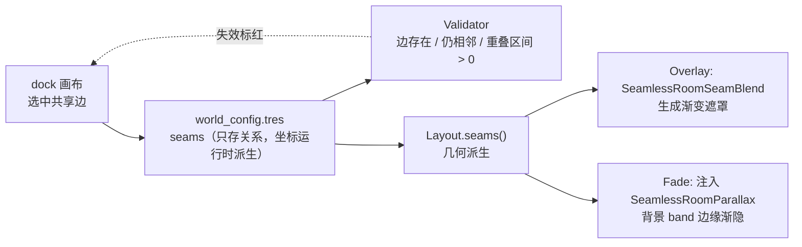
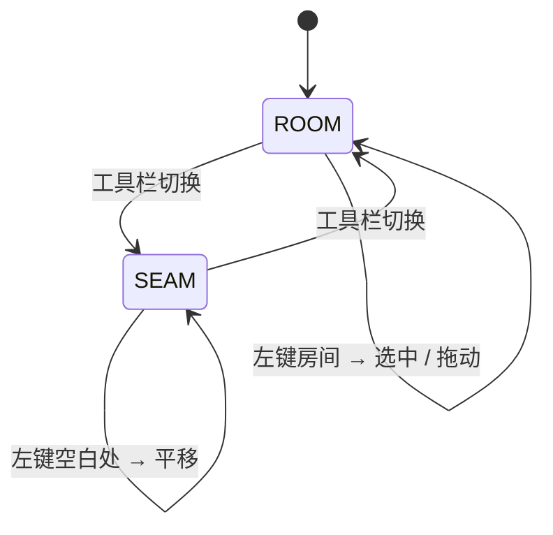

# 房间接缝过渡（Seam Blending）

> **状态**：Overlay 与 Fade 两种实现均已落地；数据、画布、校验、运行时组件共用同一份 `seams` 配置。
> 相关文档：[根 README](../README.md) · [插件 README](../addons/seamless_rooms/README.md) · [视差约定](parallax-convention.md) · [实体分层](entity-layering.md)

本文说明相邻房间共享边上的视觉硬切线如何由插件统一处理：数据放哪、画布怎么配、运行时谁渲染、参数怎么调，以及两种实现（Overlay / Fade）的适用边界。

---

## 1. 它解决什么

### 1.1 硬切线的三个成因

1. **裁剪**：`SeamlessRoomParallax._setup_rect()` 把容器尺寸强制为房间矩形，配合 `clip_contents = true`，背景在共享边被一刀切断。
2. **视差参照系**：每层按 `shift = (1 - scroll_scale) × (相机中心 - 房间中心)` 位移。`Room Center` 使相邻房同 `scroll_scale` 的层存在恒定错位 `(1-s) × Δcenter`，两房背景不可能逐像素接上。
3. **内容不对称**：两房各自的 `Backdrop` 底色、贴图密度、前景遮挡不同，共享边两侧亮度和细节同时跳变。

插件能统一解决的是**第 1 条的收尾**，以及为第 3 条提供一致的淡化机制；第 2 条属于视差参照系，不在本功能的承诺范围内。

### 1.2 插件的边界

- 插件统一「共享边发现 / 配置 / 校验 / 生命周期 / 默认实现」；
- 颜色、宽度、羽化与 shader 保持可替换；
- 插件不判断哪条边「应该有」过渡，也不替美术决定题材化外观；
- 共享边只表示两个房间矩形贴在一起，**不代表可通行**；门、传送、连通性仍属于游戏层。



---

## 2. 快速上手

### 2.1 在编辑器里启用

1. 打开底部的 **Seamless Rooms** dock，点工具栏 **`接缝模式`**。
2. 画布上会常驻绘制所有共享边（未配置为细虚线）。单击要处理的那条边。
3. 右侧接缝面板点 **`启用过渡`**，插件创建一条 `SeamlessRoomSeam`（`enabled = true`）。
4. 按需要调 `width_ratio`、`core`、`feather_*`、`color`；画布会实时显示渐变预览。
5. 点 **`保存配置`** 写回 `world_config.tres`。

### 2.2 运行时装配（Overlay，默认）

```gdscript
var blend := SeamlessRoomSeamBlend.new()
blend.config = config          # 同一份 world_config.tres
blend.z_band = -101            # 由游戏层的 z 约定决定
add_child(blend)
```

也可以直接放进主场景，在 Inspector 指定 `config`。`seam_mode` 保持默认 `Overlay`。

### 2.3 切换到 Fade

1. 在 `world_config.tres` 的 Inspector 里把 `seam_mode` 改成 `Fade`；
2. 保持 `SeamlessRoomSeamBlend` 在场景里也没关系——它会自动跳过生成；
3. 房间根节点必须继承 `SeamlessRoom2D`，且背景由 `SeamlessRoomParallax` 承载；
4. `SeamlessRoomStreamer` **首次挂载**房间时会把共享边注入，视差组件给背景 band 挂渐隐材质；休眠唤醒复用同一实例，不会重复注入。

---

## 3. 数据模型

### 3.1 SeamlessRoomSeam

`addons/seamless_rooms/runtime/seamless_rooms_seam.gd`，一条记录描述「两个房间之间的这个方向的一条边」：

| 字段 | 类型 | 默认 | 说明 |
|---|---|---|---|
| `left` | `StringName` | `&""` | 关系一端（按 id 字典序，**不代表几何方位**） |
| `right` | `StringName` | `&""` | 关系另一端 |
| `axis` | `int` | `AXIS_X` | `Vertical = 0` 竖直接缝（左右相邻，羽化沿 X）；`Horizontal = 1` 水平接缝 |
| `enabled` | `bool` | `false` | 默认关闭；只有画布上显式启用才生成 |
| `width_ratio` | `float` | `0.15` | 单侧半宽占共享边长度的比例，与房间尺寸解耦 |
| `width_max` | `float` | `0.0` | 单侧半宽的世界像素上限；`0` = 不限制 |
| `core` | `float` | `0.12` | Overlay 的中心不透明区比例；Fade 中对应完全透明的贴边区 |
| `feather_min` / `feather_max` | `float` | `1.0` | 低侧 / 高侧羽化指数；由运行时 `low_id` / `high_id` 映射 |
| `color` | `Color` | 中性暗 | 默认过渡色；可被 `material_override` 完全覆盖 |
| `material_override` | `ShaderMaterial` | `null` | 整条缝替换渲染，题材化入口 |

> **不复用 `tint`**：`tint` 只用于编辑器画布与小地图，改房间标识色不应改变运行时过渡效果。

`feather_alpha(u, core, feather)` 是唯一的羽化曲线入口，画布预览与自检共用：

\[
a(u) = \Big(1 - \operatorname{smoothstep}(\text{core}, 1, |u|)\Big)^{\text{feather}}
\]

实现用等价的 `t = clamp((|u| - core) / (1 - core), 0, 1)`、`s = t²(3 - 2t)`、`a = (1 - s)^feather`，避免 GDScript 与 GLSL 的 `smoothstep` 边界差异。

### 3.2 稳定键

```text
key = "id_a|id_b|axis"     # id_a < id_b，按字典序
```

- 按 id 而非几何方位排序，房间拖动、左右互换后配置不丢失；
- 几何左右 / 上下由 `seams()` 运行时判定，返回 `low_id` / `high_id`；
- **不持久化** `at`（接缝坐标）、`from` / `to`（重叠区间）、`span`。全部由两侧 `cells` 现算，否则拖房间必然失效。

`SeamlessRoomSeam.make_key(a, b, axis)` 是静态方法，供 `Layout.seams()`、Validator 与画布共用，避免三处各自拼键。

### 3.3 SeamlessRoomConfig 扩展

```gdscript
const SEAM_MODE_OVERLAY := 0
const SEAM_MODE_FADE := 1

@export_enum("Overlay", "Fade") var seam_mode: int = SEAM_MODE_OVERLAY
@export var seams: Array = []   # Array[SeamlessRoomSeam]，无类型便于 .tres 手写 / diff
```

`seam_configs()` 与 `placements()` 一样做类型过滤，调用方不用重复判类型。

### 3.4 兼容性

- `seams` 是可选追加字段，旧 `.tres` 加载后为空数组，行为与旧版完全一致；
- `SCHEMA_VERSION` 保持 `1`，不需要迁移；
- Validator 的 schema 版本检查不受影响；
- `seam_mode` 默认 `Overlay`，与旧配置的「无过渡」等价（因为 `seams` 为空）。

---

## 4. 几何派生

### 4.1 返回结构

`SeamlessRoomLayout.seams()` 返回 `Array[Dictionary]`，沿用项目「纯几何 API 返回 Dictionary」的风格：

```text
{
  "key":     String,       # 与 SeamlessRoomSeam.key() 一致
  "axis":    int,          # 0 / 1
  "at":      float,        # 接缝所在世界坐标（x 或 y）
  "from":    float,        # 共享边重叠区间起点（另一轴）
  "to":      float,        # 重叠区间终点
  "span":    float,        # to - from，必须 > 0
  "low_id":  StringName,   # 几何上较小 x / 较小 y 的一侧
  "high_id": StringName,   # 另一侧
}
```

`low_id` / `high_id` 决定 `feather_min`（低侧）/ `feather_max`（高侧）与渐变方向；配置本身不含方位。

### 4.2 判定规则

- **竖直接缝**：`is_equal_approx(low.end.x, high.position.x)` 且 `max(y0) < min(y1)`；`at = low.end.x`，区间取 y 重叠。
- **水平接缝**：`is_equal_approx(low.end.y, high.position.y)` 且 `max(x0) < min(x1)`；`at = low.end.y`，区间取 x 重叠。
- 浮点比较用 `is_equal_approx`；`cells` 是整数、乘 `cell_size` 后仍应精确，但保留容差。
- **必须用重叠区间，不能用 `left.merge(right)`**。L 形拼接时并集会把空白也算成接缝；例如 r7/r8 只重叠 `y ∈ [-4280, -3240]`。
- 角接触（只共享一个点）不算共享边。

### 4.3 算法与复杂度

`SeamlessRoomLayout` 用 `_nearby_ids(r)` 的桶候选比较，不跑全表 O(N²)：

1. 遍历所有房间；
2. 对每个房间只与「外扩一个桶范围」内登记过的房间比较；
3. 分别判竖直 / 水平贴合，算出重叠区间；
4. 同一条边会被两个房间各发现一次，按 `key` 去重。

`seams_for_room(id)` 在 `seams()` 结果上过滤并附加 `room_side`（`+1` = 本房间在 low 侧，`-1` = high 侧）。

`seam_fades_for_room(id)` 只保留 `enabled` 的边，并带出 `width_ratio / width_max / core / feather`；`feather` 按 `room_side` 选择 `feather_min` 或 `feather_max`。

### 4.4 示例地图的共享边基线

以下为文档基线（8 房、8 条共享边）的实测值；`world_config.tres` 是可编辑的，拖动 / 缩放房间后数量与区间都会变，以当前 `layout.seams()` 或 dock 报告为准。`world_config.tres` 为 1px 网格，`cell_size = (1,1)`。

**竖直（`axis = 0`，5 条）**

| key | `at` | 区间 | `span` | low → high |
|---|---|---|---|---|
| `r3\|r4\|0` | 741 | `[-1080, 0]` | 1080 | r4 → r3 |
| `r2\|r3\|0` | 3141 | `[-1080, 0]` | 1080 | r3 → r2 |
| `r6\|r7\|0` | 3741 | `[-4320, -3240]` | 1080 | r6 → r7 |
| `r1\|r2\|0` | 10141 | `[-1080, 0]` | 1080 | r2 → r1 |
| `r7\|r8\|0` | 10741 | `[-4280, -3240]` | 1040 | r7 → r8（部分重叠） |

**水平（`axis = 1`，3 条）**

| key | `at` | 区间 | `span` | low → high |
|---|---|---|---|---|
| `r5\|r6\|1` | -3240 | `[-1659, 741]` | 2400 | r6 → r5 |
| `r4\|r5\|1` | -1080 | `[-1659, 741]` | 2400 | r5 → r4 |
| `r1\|r8\|1` | -1080 | `[10741, 12661]` | 1920 | r8 → r1 |

> 世界 Y 轴向下增长，所以水平缝的 `low_id` 是 y 较小、画面上方的一侧。`feather_min` 作用于 `low_id`，`feather_max` 作用于 `high_id`。

`cell_size = 2` 时 `at` 与区间等比放大（例：`r1|r2|0` → `at = 20282`、`span = 2160`），已由自检覆盖。

### 4.5 边界情况

| 情况 | 处理 |
|---|---|
| 部分重叠（r7/r8） | 遮罩只覆盖重叠区间，不覆盖并集 |
| 拐角处两条边相接（r4/r5 水平 + r3/r4 竖直） | 两条遮罩会相交变暗；用预乘 alpha 合成，见 §9.2 |
| 三房在同一坐标共线 | 按房间对生成多条，配置按 key 独立 |
| `span <= 0` | 不生成；Validator 对引用它的 seam 报 WARN |
| 房间被删除 / 改名 | 配置保留但报 WARN（不自动删，便于撤销） |
| `cell_size ≠ 1` | `world_rect()` 已统一换算，`seams()` 只操作世界坐标 |
| 两房 x 或 y 完全不重叠 | 不构成共享边，没有过渡 |

---

## 5. 编辑器工作流

### 5.1 两种模式

工具栏的 **`接缝模式`** 按钮在「房间模式」与「接缝模式」之间切换：



**接缝模式下禁用房间拖动**，避免「选边」与「拖房间」抢左键；空白处平移、滚轮缩放、右键平移保持可用。命中检测 `_hit_seam()` 把屏幕坐标转世界坐标，在 `seams()` 结果里找垂直距离小于 `10 / zoom` 世界像素、且另一轴落于 `[from, to]` 的边。

### 5.2 常驻绘制

共享边在两种模式下都绘制：

| 状态 | 画法 |
|---|---|
| 未配置 | 低对比细虚线（`SEAM_IDLE`） |
| 已启用且有效 | 绿色实线 + 两侧渐变预览 |
| 鼠标悬停 / 选中 | 黄色高亮，选中更粗 |
| 已启用但失效 | 红色虚线（`SEAM_INVALID`） |

渐变预览按 24 段离散绘制，`alpha = feather_alpha(u, core, feather) × color.a × 0.55`。**0.55 只是编辑器显示系数**，避免预览盖住房间底色，不参与运行时计算。

### 5.3 属性面板与撤销

`world_canvas` 在接缝模式下把右侧 Inspector 切为接缝属性：

- `enabled`、`width_ratio`、`width_max`、`core`、`feather_min`、`feather_max`、`color`；
- 新建 / 删除一条 seam 走 `EditorUndoRedoManager` 的 `add_do_property(config, "seams", ...)` / `add_undo_property(...)`；
- 参数修改同样走 `_set_property()`，与房间属性编辑共用 `_after_change()`：重绘、校验、脏标记一次完成；
- 选中一条**尚不存在配置**的边时只显示「启用过渡」按钮，点击才创建 `SeamlessRoomSeam`，避免给全图所有边生成配置对象；
- 面板标题显示 `Seam: key · span N px`；失效时追加「接缝已失效（房间被移动或改过尺寸）」。

### 5.4 失效边

`_invalid_seam_keys()` 每次校验现算：`enabled` 但 `layout.seams()` 中找不到对应 key 的配置。它把 key 交给画布标红，同时 Validator 追加 WARN。**失效边不阻断运行**：地图编辑过程中房间会短暂不对齐，运行时组件直接跳过失效边即可。

---

## 6. Overlay：接缝遮罩

### 6.1 节点契约

`addons/seamless_rooms/companion/seamless_rooms_seam_blend.gd`（可删）：

```text
SeamlessRoomSeamBlend (Node2D)
├─ config: SeamlessRoomConfig        # 游戏层注入，或 configure() 传入
├─ z_band: int = -101               # 游戏层按自己的 z 约定指定
├─ default_material: ShaderMaterial # 可整体替换
└─ (运行时生成) Veil_<key>: ColorRect × N
```

与 `SeamlessRoomMinimap` / `SeamlessRoomParallax` 一致：**不认识相机、不寻找节点、不驱动任何 `Camera2D`**；放在 `Main` 下还是某个 `CanvasLayer` 由游戏层决定。

### 6.2 生成流程

1. `configure(p_config)` 保存配置；节点已 ready 时立即重建。
2. `_ready()` 调 `_rebuild()`：先释放上一批遮罩。
3. `seam_mode = Fade` → 直接返回（避免与 Fade 双重衰减）。
4. 用 `SeamlessRoomLayout.new(config).seams()` 建 key → 几何索引。
5. 遍历 `config.seam_configs()`，只处理 `enabled`；失效边（房间被移动 / 改尺寸）或 `span <= 0` 跳过。
6. 每条边生成一个 `ColorRect`：
   - 竖直：`position = (at - w, from)`，`size = (2w, span)`；
   - 水平：`position = (from, at - w)`，`size = (span, 2w)`；
   - `w = span × width_ratio`，`width_max > 0` 时再取 `min(w, width_max)`；`w <= 0` 跳过；
   - 节点名 `Veil_<key>`（`|` 换成 `_`）。
7. 材质：`material_override` 优先（原样使用，不覆盖 uniform）；否则复制 `default_material`，再否则新建 `ShaderMaterial` 并挂默认 shader；每条边独立材质。
8. `mouse_filter = MOUSE_FILTER_IGNORE`；`color = seam.color` 作为 shader 失效时的兜底色。

静态地图（房间集合运行期不变）下只在 ready / `configure()` 时生成一次，不做每帧更新。

### 6.3 默认 shader 与预乘契约

`companion/seamless_rooms_seam_blend.gdshader`：

```glsl
shader_type canvas_item;
render_mode blend_premul_alpha;

uniform vec4 veil_color = vec4(0.02, 0.03, 0.025, 1.0);
uniform float axis = 0.0;          // 0 = UV.x 竖直缝，1 = UV.y 水平缝
uniform float core = 0.12;
uniform float feather_min = 1.0;   // 低侧
uniform float feather_max = 1.0;   // 高侧

void fragment() {
	float u = mix(UV.x, UV.y, axis) * 2.0 - 1.0;
	float a = veil_color.a * pow(1.0 - smoothstep(core, 1.0, abs(u)),
			mix(feather_min, feather_max, step(0.0, u)));
	COLOR = vec4(veil_color.rgb * a, a);   // 预乘：rgb 必须先乘 alpha
}
```

- 中心 `u = 0` 必须落在共享边上且 alpha 最大，这是硬线被完全遮住的前提。
- **预乘契约**：`blend_premul_alpha` 下 `COLOR.rgb` 必须已乘 `COLOR.a`，否则羽化边缘会出现灰白边。`material_override` 若替换 shader，必须声明同一 render mode 并预乘 RGB；Validator 会检查源码里是否出现 `blend_premul_alpha` 并给 WARN。
- 预乘 alpha 的 over 合成满足结合律：两条同色遮罩在拐角叠加，等价于一层更高不透明度的遮罩，不会因重复插值产生灰边。因此**不缩短端点**，`width_ratio` 保持原值。
- `core` 通用默认 `0.12` 留出一段不透明核心；示例按已调好的观感覆写为 `0.0`，属于单条 seam 的参数覆写，不改通用默认。

### 6.4 生命周期与 z band

- 组件常驻游戏层，不随房间休眠 / 卸载消失 —— 这是 Overlay 相对 Fade 的优点（不会出现半边空白），也是缺点（房间卸载后可能留下孤立暗带）。
- `z_band` 由游戏层按自己的 z 约定覆写；组件默认 `-101`，示例正好用它压住 `z = -121…-102` 的背景 Sprite，保留 `WorldGrid` 的 `-100`，不影响 `World` / `Actors`。
- 相邻两条遮罩在拐角相交时按 `blend_premul_alpha` 合成，不缩短端点。

---

## 7. Fade：背景层边缘渐隐

### 7.1 动机与差异

Overlay 是「在背景之上盖一层」。Fade 让 `SeamlessRoomParallax` 的背景层在共享边附近自行淡出到房间的实心底色：

- 不需要 `Main` 层常驻节点，房间休眠 / 卸载不会留下孤立暗带；
- 不需要 z band 约定，不会顺带压住 `WorldGrid`；
- 过渡是内容自身消隐，通常比覆盖层自然。

代价是依赖 `SeamlessRoomParallax`；直接用原生 `Parallax2D` 的项目要回退到 Overlay。

### 7.2 注入链路

`SeamlessRoomStreamer._mount_now()` 在**首次挂载**房间（实例化）时：

```gdscript
if room.has_method("configure"):
    var fades: Array = []
    if layout.config.seam_mode == SeamlessRoomConfig.SEAM_MODE_FADE:
        fades = layout.seam_fades_for_room(id)
    if fades.is_empty():
        room.call("configure", id, layout.placement(id), layout.cell_size())
    else:
        room.call("configure", id, layout.placement(id), layout.cell_size(), fades)
```

- 只有 `Fade` 模式且该房确有启用的边时才传第 4 个参数；自定义房间子类不接受第 4 个参数也不会被破坏。
- `SeamlessRoom2D.configure()` 把边记到 `seam_edges`，`SeamlessRoomParallax._ready()` 从父房间读取。
- 注入项带上 `room_side`、`width_ratio`、`width_max`、`core`、`feather`，房间侧不需要再认识 `config`。

### 7.3 应用范围

`SeamlessRoomParallax._apply_room_seams()`：

1. 父节点必须是 `SeamlessRoom2D`，否则不处理；
2. `seam_edges` 为空 → 不处理；
3. 只处理有效 `z <= 0` 的 band（示例是 `Far / Far2 / Mid / Near`）；
4. `FgParallax` 的前景层不参与；
5. band 下所有没有独立材质的子节点打开 `use_parent_material`，已有自定义材质的保持原样；
6. `Backdrop` 是普通 `Node2D`，不挂 `SeamlessRoomParallaxLayer`，因此 `Darkness` 与实心底色不被渐隐——这正是「淡出到公共底色」的实现方式。

每间房最多应用 **2 条**共享边（shader 用 `seam_a / seam_b` 两个槽位）；超出时 `push_warning` 并只取前 2 条。示例每间房最多 2 条，不受影响。

`clip_to_room` 仍需保持开启：渐隐边界固定在世界坐标，不随视差层滑动；关闭后背景可能画进相邻房间。

### 7.4 Fade shader

`companion/seamless_rooms_seam_fade.gdshader`：

```glsl
shader_type canvas_item;

uniform int seam_count = 0;
uniform vec4 seam_a = vec4(0.0);   // x=at, y=axis, z=half_width, w=side
uniform vec4 seam_b = vec4(0.0);
uniform float core_a = 0.12;
uniform float core_b = 0.12;
uniform float feather_a = 1.0;
uniform float feather_b = 1.0;
varying vec2 world_pos;

void vertex() {
	world_pos = (MODEL_MATRIX * vec4(VERTEX, 0.0, 1.0)).xy;
}

float edge_alpha(vec4 s, float p_core, float feather) {
	float p = mix(world_pos.x, world_pos.y, s.y);
	float d = s.w * (s.x - p) / max(s.z, 1.0);
	float t = clamp((d - p_core) / max(1.0 - p_core, 0.0001), 0.0, 1.0);
	float st = t * t * (3.0 - 2.0 * t);
	return pow(st, max(feather, 0.0001));
}

void fragment() {
	float a = 1.0;
	if (seam_count > 0) {
		a *= edge_alpha(seam_a, core_a, feather_a);
	}
	if (seam_count > 1) {
		a *= edge_alpha(seam_b, core_b, feather_b);
	}
	COLOR.a *= a;
}
```

- 顶点用 `MODEL_MATRIX` 换算到世界坐标，`varying` 传给 fragment；渐变边界因此固定在世界空间，不随层位移。
- `d` 是「到共享边的有符号距离 / 半宽」；`room_side` 保证两侧都向房间内部递增。
- 在接缝处 `d = 0` → alpha = 0（完全露出底色）；离开羽化带后 alpha = 1。
- 与 Overlay 共用同一组 `core / feather` 参数族，但方向相反：Overlay 是「中心不透明、两端透明」，Fade 是「贴边透明、内部不透明」。

### 7.5 Fade 的限制

- 必须有背景层（`z <= 0` 的 `SeamlessRoomParallaxLayer`）；纯静态 `Sprite2D` 房间请用 Overlay。
- 每房最多 2 条边。
- 背景层必须能被 `use_parent_material` 覆盖；已有独立材质的子节点保持原样，可能不被渐隐。
- 分屏 / 多 `SubViewport` 与现有视差契约一致，不支持。

---

## 8. 校验规则

`SeamlessRoomValidator.validate()` 追加以下规则，沿用 `{ "errors": Array[String], "warnings": Array[String] }` 与 `format()`；所有文案走 `SeamlessRoomI18n.t / tf`（英文 key + `ZH` 对照）。

| 级别 | 条件 | 说明 |
|---|---|---|
| ERROR | `seams[i]` 不是 `SeamlessRoomSeam` | 类型错误 |
| ERROR | `left` / `right` 为空或相等 | 关系两端非法 |
| ERROR | `axis` 不在 `{0, 1}` | 方向非法 |
| ERROR | `width_ratio <= 0`、`core < 0`、`feather_* <= 0` | 参数非法 |
| ERROR | 同一 `key` 重复 | 配置重复 |
| WARN | `enabled` 但两房 id 有任一不在 `rooms` 中 | 引用了不存在的房间 |
| WARN | `enabled` 但 `seams()` 中找不到该 key | 两房不再共享这条边（拖动 / 改尺寸后常见） |
| WARN | `enabled` 但派生 `span <= 0` | 共享边退化为点 |
| WARN | `material_override != null` 但缺少 `shader` | 回退默认 shader |
| WARN | `material_override` 的 shader 未声明 `blend_premul_alpha` | 预乘契约不一致，拐角叠加会出现灰边 |

**失效边不阻断运行**：地图编辑过程中房间会短暂不对齐，标红 + WARN 比 ERROR 更合适；运行时组件跳过失效边即可。

Validator **不查**：连通性、可达性、门对齐、美术效果——这些不是布局层的职责。

---

## 9. 调参与常见问题

### 9.1 参数怎么取

| 参数 | 取法 |
|---|---|
| `width_ratio` | 单侧半宽占共享边长度的比例。先用 `0.1 ~ 0.2` 起步，再用画布预览调整；总值是 `2 × ratio × span` |
| `width_max` | 房间很大、`span × ratio` 过宽时设世界像素上限；`0` 表示不限制 |
| `core` | Overlay 中心不透明区比例；`0` = 从接缝开始就衰减，`0.12` = 中心留 12% 不透明带。Fade 中这是贴边的全透明带 |
| `feather_min` / `feather_max` | 羽化指数，越大过渡带越窄、衰减越快；两侧可以不对称 |
| `color` | 默认过渡色；Overlay 用它做兜底，Fade 不使用（露出的是 `Backdrop` 底色） |
| `material_override` | 需要题材化外观时整体替换；必须遵守预乘 alpha 契约 |

推荐工作流：先在编辑器里用 `color` + 默认 shader 调宽度和羽化，确认观感后再决定是否写自定义 shader。示例的 `core = 0.0` / `feather_min = 1.35` / 暗绿色是单条边覆写，不代表插件默认值。

### 9.2 拐角叠加

两条边在拐角相交时（例如 r4/r5 水平缝与 r3/r4 竖直缝在 `(741, -1080)` 相接），Overlay 会生成两个相交的 `ColorRect`：

- `blend_premul_alpha` + 预乘 RGB 让合成可结合，同色叠加等价于更高不透明度，不会出现灰边；
- **不缩短端点**，`width_ratio` 保持原值；
- 两条颜色差异很大时，拐角仍会看到色相叠加，这是美术选择，不是实现缺陷。需要严格控制时，把两条边的颜色调成同一族，或改用 Fade。

### 9.3 房间移动 / 改尺寸后

配置保留，但 `layout.seams()` 找不到对应边：

- 画布标红，右侧显示「接缝已失效」；
- Validator 追加 WARN，不阻断运行；
- 运行时 Overlay 跳过、Fade 不注入；
- 把房间移回原位即可恢复；不需要重新创建 seam。

这是把坐标从配置里去掉的直接收益：拖动房间不会产生「坐标过期」的第二种失效模式。

### 9.4 自定义 shader

`material_override` 的 shader 必须：

1. `shader_type canvas_item;`
2. `render_mode blend_premul_alpha;`
3. 输出 `COLOR.rgb` 已乘 `COLOR.a`；
4. 中心对齐共享边（竖直缝随 `axis = 0`，水平缝随 `axis = 1`）；
5. 保留 `core / feather_min / feather_max` 的语义，或至少保证接缝中心不透明、两端透明。

否则 Validator 只能检查到第 2 条（源码里出现 `blend_premul_alpha`），观感问题需要人工验收。

### 9.5 房间卸载

- **Overlay**：遮罩在 `Main` 层，r1/r2 都卸载后仍覆盖那片世界区域，形成孤立暗带。需要跟随房间显隐时，由游戏层监听 `room_sleeping` / `room_mounted` 手动控制，或改用 Fade。
- **Fade**：材质挂在房间自己的背景 band 上，房间卸载即消失，没有残留。

### 9.6 常见现象排查

| 现象 | 排查 |
|---|---|
| 没有遮罩 | `config` 是否注入；`enabled` 是否为 true；边是否仍然有效；`width_ratio × span` 是否 > 0；`seam_mode` 是否为 Fade |
| 遮罩被背景盖住 | `z_band` 是否高于背景 Sprite 的 z（示例背景在 `-121…-102`，遮罩 `-101`） |
| 遮罩盖住世界网格 | `z_band` 是否压到了 `WorldGrid`（示例 `-100`）；把遮罩调到 `-101` |
| 羽化边缘发灰 / 发白 | 自定义 shader 是否漏了预乘 RGB |
| Fade 没生效 | 父节点是否 `SeamlessRoom2D`；是否存在 `z <= 0` 的视差 band；`seam_mode` 是否为 Fade；该房是否超过 2 条边 |
| Fade 只淡了部分 Sprite | 子节点是否已有独立材质（不会被 `use_parent_material` 覆盖） |
| 房间移动后没有过渡 | 边已失效，按 §9.3 处理 |

---

## 10. 实测基线

`example/tests/seam_probe.gd` 覆盖数据、几何、校验、画布公式、Overlay 组件与 Fade 注入；在文档基线的 8 房地图上 **49 项全部通过**（若地图被改动，边数与区间断言需要同步更新）：

- 旧配置 `seam_configs()` 为空，既有校验结论不变；
- 示例配置含 1 条启用的 `r1|r2|0` 接缝，保留 `core = 0.0`、`width_ratio = 1/3`、`feather_min = 1.35`、示例绿色；
- 8 房地图返回 8 条共享边（5 竖直 / 3 水平），r7/r8 部分重叠只取 1040，不取并集；
- `cell_size = 2` 时 `at` 与区间等比放大；
- 失效边、重复键、非法参数、预乘契约分级正确；
- 画布预览公式与 GLSL 等价写法在 21 个采样点 × 9 组参数上误差 < 0.01；
- 含 `seams` 的配置可保存 / 读回，key 与颜色不丢失；
- Overlay 组件按 seam 生成 1 条遮罩，位置 `x = 10141 - 360`、尺寸 `720 × 1080`、`z = -101`、`mouse_filter = IGNORE`，材质带 `blend_premul_alpha`；
- `main.tscn` 端到端生成 1 条遮罩并保留示例绿色；
- Fade 模式下组件不生成遮罩；`r2` 的 2 条几何接缝中 1 条启用；背景 band 自动挂材质、子 Sprite 开启 `use_parent_material`、`FgParallax` 不受影响；
- streamer 真实挂载 r2 时注入 1 条 `seam_edges`，背景 band 自动挂上渐隐材质。

`room_template_probe.gd` 同时通过，确认 8 间房的层结构与视差默认值没有被接缝改动破坏。

---

## 11. 设计决策

| 决策 | 理由 |
|---|---|
| 配置进 `world_config.tres` 而不是 `main.tscn` | 房间几何由 dock 编辑，配置写在场景节点上会形成两个数据源；拖动房间后没有任何反馈，字符串引用会静默失效 |
| 坐标不持久化 | `cells` 是整数、可校验、无浮点误差；共享边由整数相加得出。派生坐标让拖动房间成为零成本操作 |
| 键按 id 字典序而非几何方位 | 房间相对位置变化时配置不丢失；方位由 `seams()` 运行时给出 |
| 默认 `enabled = false` | 8 房地图实测 8 条共享边，只有真正需要的那条应该生成；不自动给空白房之间加暗带 |
| 宽度用 `width_ratio` 比例制 | 插件默认值必须中立，不能绑定示例的 1080 px 房高；比例制让不同尺寸房间无需重配 |
| 不加 `segment` | 当前地图每对房间最多一条共享边；多段边共用同一份美术参数符合直觉，等真实出现「同一对房间两段边要不同颜色」再扩展 |
| 用 `blend_premul_alpha` 而不是缩短端点 | 预乘 alpha 的 over 合成可结合，拐角叠加不会因重复插值产生灰边，也不用牺牲 `width_ratio` |
| 示例保留绿色与 `core = 0.0` | 这是使用方已调好并确认的观感；插件通用默认（`core = 0.12`）不应覆盖项目自己的美术选择 |
| `seam_mode` 放配置 | Streamer、遮罩组件、视差组件读同一份数据，避免「组件配 Overlay、房间配 Fade」互相打架 |
| Fade 每房 2 个槽位 | 避免 uniform 数组随边数膨胀；超出时告警并只取前 2 条，示例房间最多 2 条 |
| `tint` 不复用为过渡色 | 改房间标识色不应改变运行时过渡效果 |

---

## 12. 限制与路线

### 12.1 已知限制

- **Overlay 常驻**：房间卸载后遮罩不消失，可能留下孤立暗带；需要随房间消失时用 Fade。
- **Fade 依赖 `SeamlessRoomParallax`**：原生 `Parallax2D` 项目只能用 Overlay；纯静态背景也无法渐隐。
- **Fade 每房最多 2 条边**：更多边需要扩展 shader 槽位。
- **不支持逐像素连续的背景**：两房视差错位仍在，Fade 只是把硬切线变成渐变，不承诺接缝两侧图案对齐。
- **只支持轴对齐矩形**：`cells` 是 `Rect2i`，不支持旋转房间、斜接缝、多边形房间。
- **Overlay 的开销是 N 条边 = N 个 `ColorRect` + N 个 `ShaderMaterial`**：接缝数量很大时需要评估绘制调用；`CanvasGroup` 可合并但与 `clip_to_room` 冲突，暂不采用。
- **分屏 / 多 `SubViewport` 不支持**：与现有视差契约一致。

### 12.2 后续可做

- 每房超过 2 条边的 Fade；
- 接缝外观预设（宽度 / 羽化 / 颜色的可复用资源）；
- 校验结果可点击定位到画布；
- 无限平铺背景（`repeat_size` / `autoscroll`），与视差二期一起推进。

---

## 附录：相关文件

| 文件 | 职责 |
|---|---|
| `addons/seamless_rooms/runtime/seamless_rooms_seam.gd` | `SeamlessRoomSeam` 资源与键 / 羽化纯函数 |
| `addons/seamless_rooms/runtime/seamless_rooms_config.gd` | `seam_mode` + `seams` + `seam_configs()` |
| `addons/seamless_rooms/runtime/seamless_rooms_layout.gd` | `seams()` / `seams_for_room()` / `seam_fades_for_room()` |
| `addons/seamless_rooms/runtime/seamless_rooms_room2d.gd` | `configure()` 第 4 参数、`seam_edges` |
| `addons/seamless_rooms/runtime/seamless_rooms_streamer.gd` | Fade 模式注入 |
| `addons/seamless_rooms/editor/seamless_rooms_grid_canvas.gd` | 接缝模式、命中、绘制、渐变预览 |
| `addons/seamless_rooms/editor/seamless_rooms_world_canvas.gd` | 接缝属性面板、创建 / 删除 / 参数 undo |
| `addons/seamless_rooms/editor/seamless_rooms_validator.gd` | 接缝校验规则 |
| `addons/seamless_rooms/companion/seamless_rooms_seam_blend.gd` | Overlay 组件 |
| `addons/seamless_rooms/companion/seamless_rooms_seam_blend.gdshader` | 遮罩 shader（预乘） |
| `addons/seamless_rooms/companion/seamless_rooms_parallax.gd` | Fade 应用与批量材质 |
| `addons/seamless_rooms/companion/seamless_rooms_seam_fade.gdshader` | 背景边缘渐隐 shader |
| `example/tests/seam_probe.gd` | 49 项 headless 自检 |
